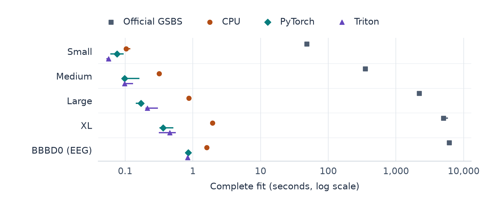
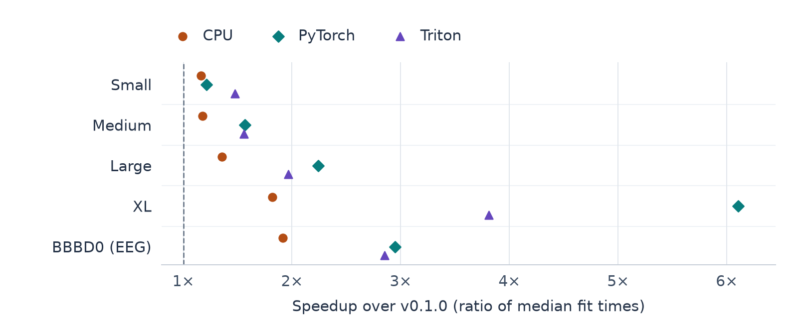

# HP-GSBS

**High-Performance Greedy State Boundary Search for EEG, fMRI, and other multivariate time series.**

[](https://github.com/JustinZHAO-05/HP-GSBS/releases/tag/v0.2.0)
[](https://github.com/JustinZHAO-05/HP-GSBS/actions/workflows/tests.yml)
[](LICENSE)

[简体中文](README.zh-CN.md) · [Documentation](docs/index.md) · [Paper](https://arxiv.org/abs/2610.25898) · [Research data and code](https://github.com/JustinZHAO-05/HP-GSBS-SoftwareX-Reproducibility)

## Features

Give HP-GSBS a preprocessed **time × features** matrix, such as EEG channels or fMRI voxels. It finds successive periods with stable spatial activity patterns and returns their boundaries, the selected number of states, state patterns, boundary strengths, and the full t-distance curve.

- **Fit one recording or a batch.** Each recording gets its own segmentation. Use the Python API or the command line, and save results as NumPy archives.
- **Choose a backend.** Use `cpu-fast` on CPU, `torch-cuda` or `triton-cuda` on NVIDIA GPUs, or `reference` to run the original GSBS implementation.
- **Inspect the outputs.** FP64 is the default. You can examine boundaries at different state counts and record search and refinement traces. [API and validation](docs/v02_api_scope.md) · [Release verification](docs/release_verification_v0.2.0.md)

## Performance

**HP-GSBS v0.2.0 vs. official GSBS.** On one BBBD EEG recording, a complete fit took 6,115 s with the official implementation, 1.61 s with HP-GSBS on CPU, and 0.84 s with Triton. These measurements come from separate sessions on the same laptop.



Dots show synthetic medians or single EEG timings. Lines show the observed ranges across three timed synthetic fits. [Protocol and full timing table](docs/v020_official_comparison.md)

**v0.2 vs. v0.1.0.** In a separate interleaved benchmark, speedups for the measured v0.2 snapshot ranged from **1.16× to 6.11×** across workloads and backends.



[Version comparison and benchmark details](docs/performance.md#retained-v010-versus-v02-comparison)

## How it works

GSBS greedily inserts one or two boundaries where splitting improves the fit of the spatial activity patterns. It refines the boundaries and uses t-distance, which contrasts within-state similarity with similarity between adjacent states, to select a state count.

HP-GSBS precomputes reusable interval statistics, so candidate splits can be scored without repeatedly rebuilding segment means. It evaluates candidates in chunks and reuses scores in unchanged blocks. The CUDA backends compute interval scores on the GPU and use the shared CPU controller for sequential search and refinement. [Mathematics](docs/mathematics.md) · [Architecture](docs/architecture.md)

## Usage

Requires **Python 3.10+**. Install the CPU-ready wheel from the v0.2.0 release.

```bash
python -m pip install https://github.com/JustinZHAO-05/HP-GSBS/releases/download/v0.2.0/hpgsbs-0.2.0-py3-none-any.whl
```

Fit a synthetic time series with four successive patterns. For real data, replace `x` with your preprocessed matrix and set `kmax` and `dmin` for your study.

```python
import numpy as np
from hpgsbs import GSBSConfig, fit

rng = np.random.default_rng(42)
patterns = rng.normal(size=(4, 8))
x = np.repeat(patterns, 20, axis=0) + 0.15 * rng.normal(size=(80, 8))
result = fit(x, GSBSConfig(kmax=12, dmin=1), backend="cpu-fast")

print(result.nstates)                    # selected number of states
print(np.flatnonzero(result.deltas))     # boundary indices
result.save("segmentation.npz")
```

If you already have a NumPy input file, you can fit it from the command line.

```bash
python -m hpgsbs fit input.npy --kmax 12 --output segmentation.npz
```

For GPU use, install a compatible CUDA build of [PyTorch](https://pytorch.org/get-started/locally/) and select `torch-cuda`. For `triton-cuda`, also install [Triton](https://triton-lang.org/main/getting-started/installation.html) on Linux/WSL. Run `python -m hpgsbs doctor` to check which backends are available.

For multiple recordings, use `fit_many` or `fit-batch` with a [task manifest](examples/tasks.json). [Complete example](examples/quickstart.py) · [API and CLI details](docs/v02_api_scope.md)

---

Please cite the [HP-GSBS paper](CITATION.cff), the [software release](https://doi.org/10.5281/zenodo.23422148), and the original GSBS studies ([2021](https://doi.org/10.1016/j.neuroimage.2021.118085), [2022](https://doi.org/10.7554/eLife.77430)). [Manuscript and reproducibility materials](docs/publication.md) · [MIT license](LICENSE)
