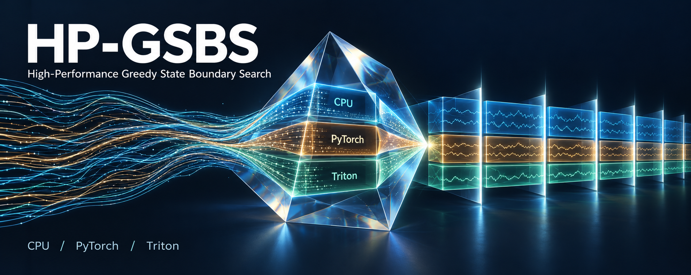
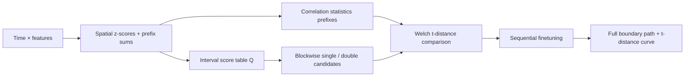

<div align="center">



# HP-GSBS

**High-Performance Greedy State Boundary Search**

Find temporal states in multivariate neural recordings—with faster computation and auditable decisions.

[](https://github.com/JustinZHAO-05/HP-GSBS/actions/workflows/tests.yml)
[](pyproject.toml)
[](LICENSE)
[](#scientific-consistency)

[Quick start](#quick-start) · [Performance](#measured-performance) · [How it works](#how-the-acceleration-works) · [Downloads](https://github.com/JustinZHAO-05/HP-GSBS/releases) · [简体中文](README.zh-CN.md)

</div>

## What is it for?

GSBS segments a **time × features** matrix into successive states with relatively stable spatial activity patterns. HP-GSBS accelerates this search for EEG, ROI analyses, and large collections of independent recordings. It was developed against BBBD educational-video EEG inputs; the same API accepts other appropriately prepared multivariate signals.

You supply the already-preprocessed matrix and the original analysis parameters. HP-GSBS returns boundaries, states, the complete t-distance curve, state patterns, and boundary strengths. Your preprocessing, artifact policy, K-selection rule, and downstream statistics remain under your control.

| Route | Implementation | Best starting point |
|---|---|---|
| **CPU FastGSBS** · `cpu-fast` | NumPy/BLAS precomputation, Numba search, independent process workers | Portable use and many short recordings |
| **TensorGSBS** · `torch-cuda` | Batched PyTorch CUDA precomputation + sequential CPU controller | NVIDIA GPU fitting without requiring Triton |
| **TurboGSBS** · `triton-cuda` | Custom Triton interval-score kernel + shared controller | Latency across sizes; benchmark your workload |
| **Official reference** · `reference` | Calls unmodified `statesegmentation.GSBS` | Baselines and decision-by-decision validation |

**The GPU routes are hybrid implementations.** Q/correlation/statistics precomputation runs on CUDA; dependent greedy search and finetuning remain on CPU. Every recording keeps an independent search path. Triton is actually executed, but it is not universally the fastest backend.

## Measured performance

**All five workloads have measured official FP64 baselines.** Each speedup compares identical inputs, parameters, environment and precision within that workload; Small ratios are not extrapolated to larger recordings.

### Single-record latency

Ryzen 7 7840H · RTX 4050 Laptop 6 GB · WSL2 Ubuntu 22.04 · PyTorch 2.11.0+cu128 · Triton 3.6.0. Synthetic values are medians of **3 fits after warmup**; BBBD0 reports **one measured fit per backend, without repeats**, with CUDA synchronization. CPU uses one process and one BLAS thread. All rows use statewise detection, `finetune=1`, strength-ordered finetuning, `blocksize=50`, and FP64; TF32 is disabled.

| Workload | T × P | Kmax | Official GSBS | CPU FastGSBS | TensorGSBS | TurboGSBS |
|---|---|---|---|---|---|---|
| Small · synthetic | 450 × 16 | 20 | 48.035 s | 0.169 s | 0.110 s | 0.098 s |
| Medium · synthetic | 900 × 32 | 30 | 349.946 s | 0.455 s | 0.276 s | 0.328 s |
| Large · synthetic | 1500 × 64 | 40 | 2213.493 s | 1.659 s | 0.673 s | 0.515 s |
| XL · synthetic | 2100 × 64 | 50 | 5011.254 s | 3.778 s | 2.314 s | 2.229 s |
| BBBD0 · real EEG | 1336 × 64 | 131 | 6115.379 s | 4.489 s | 3.738 s | 3.421 s |

Speedup relative to official GSBS:

| Workload | CPU | PyTorch | Triton |
|---|---|---|---|
| Small | 285.0× | 438.4× | 489.1× |
| Medium | 768.5× | 1265.7× | 1066.6× |
| Large | 1334.1× | 3287.4× | 4300.9× |
| XL | 1326.5× | 2165.6× | 2248.1× |
| BBBD0 | 1362.3× | 1636.2× | 1787.4× |

Small retains its original v0.1.0 same-environment measurements. Medium, Large and XL were remeasured in one WSL process: one warmup round, then three rounds of reference/CPU/PyTorch/Triton in sequence, reporting three-fit medians. At the user's request, BBBD0 was measured once per backend in that same process: these are single-fit ratios with no repeat-variability estimate. The original log's warmup label identifies this retained single EEG run. Synthetic dmin=1; real EEG dmin=5. Tracing is disabled, saving/validation are outside timing, and no other GSBS fits run concurrently. The earlier traced Windows reference is excluded from these ratios.

### Throughput and startup are different questions

For **32 independent Small recordings**, measured batch medians were:

| Configuration | Batch wall time | Fits/minute |
|---|---:|---:|
| CPU · 8 workers, 1 BLAS thread each | **1.006 s** | **1,908** |
| PyTorch · B=32 | 1.684 s | 1,140 |
| Triton · B=32 | 1.909 s | 1,006 |

New-process, empty-JIT-cache startup for one Small fit was **3.44 s CPU / 7.96 s PyTorch / 10.55 s Triton**, including import and initialization. Warm timings should not be used to predict first-run latency. These desktop/WSL measurements included background resource contention; they are not dedicated-server results.

→ [Full timing, memory, cold-start and profiler report](docs/performance.md) · [Latency receipts](results/benchmarks/delivery_latency.json) · [CPU batch receipts](results/benchmarks/batch_cpu8.json)

## Scientific consistency

Acceleration is based on mathematical reuse, **without lowering Kmax, downsampling, disabling double-boundary search, or switching off finetuning**.

The controller preserves official block grouping, double-boundary candidates within a single existing state, single-vs-double **t-distance** decisions, sequential finetuning and boundary numbering, sample spatial z-scores (`ddof=1`), `dmin`, and the special K indexing that can reach `kmax+1`. Optional `y` is supported: search uses `x`, while t-distance uses `y`.

| Validation evidence | Result |
|---|---|
| Paired baseline completion: 52 saved fits across 3 synthetic inputs + 1 EEG input | All K boundaries and selected K match; maximum t-distance difference vs CPU **2.44×10⁻¹³**; patterns/strengths pass. Timed fits do not collect candidate traces. |
| Original local Windows suite | 103 passed, 1 GPU-module skip |
| Original WSL suite, including CUDA/Triton | 134 passed |
| Four complete EEG inputs: full64/frontal32, two sessions, four videos | CPU `all_bounds` matches historical official outputs at every K; maximum t-distance error **7.46×10⁻¹³** |
| Fresh unmodified official fit: 1336 × 64, Kmax=131 | All three FP64 routes match every recorded candidate decision and pre/post-finetuning boundary path; maximum t-distance error **2.44×10⁻¹³** |
| Both GPU FP64 routes vs validated CPU traces, four full inputs | **4/4** full-path comparisons pass per backend |
| Both GPU FP32 routes, same four inputs | Boundaries match, but **0/4** pass strict numerical tolerance per backend |

Tests compare candidate scores, single/double t-values, every recorded decision, all K boundaries, final K, patterns, and strengths—not just the final K. Initial numeric tolerances are `atol=rtol=1e-8`; FP32 errors of approximately `4e-5`–`3.54e-4` exceed them. **FP64 is the scientific default. FP32 is experimental.** TF32 is not exposed as a fit mode.

Near-tied candidates are re-evaluated in the original operation order. Ill-conditioned near-constant spatial inputs can fall back to the official reference, with the actual backend and reason recorded. P=1, nonfinite inputs, and spatially constant rows are rejected. This is evidence for the tested domain, not a proof of identical floating-point decisions for every possible input.

Private EEG arrays and individual fitted outputs are not redistributed. Public CI runs the reproducible synthetic tests; private-fixture and optional fork-audit tests skip when their inputs are absent. Test counts are test cases, not participant counts. Source-network inputs have **not yet been validated**.

→ [Detailed validation](docs/reference_parity.md) · [Comparison receipts](results/benchmarks/saved_validation.json) · [Known limits](docs/known_limitations.md)

## Quick start

### 1. Download and install

Requires **Python 3.10+**. Python 3.10/3.11 were used in the recorded validation. CPU-only installation does not install PyTorch or Triton.

```bash
git clone https://github.com/JustinZHAO-05/HP-GSBS.git
cd HP-GSBS
python -m venv .venv
```

Activate the environment:

```bash
# Linux / WSL / macOS shell
source .venv/bin/activate
```

```powershell
# Windows PowerShell; alternatively use .venv\Scripts\python.exe directly
.venv\Scripts\Activate.ps1
```

```bash
python -m pip install -e ".[test]"
python -m hpgsbs doctor
python examples/quickstart.py
```

The example generates an 80×8 synthetic recording, fits both CPU and official GSBS, verifies the full trace, and saves `examples/generated/input.npy` and `fit.npz`. It needs no private data. Outputs are protected against overwrite; choose another `--output` directory to repeat it.

Prefer a download? Use **Code → Download ZIP** and run the same installation commands inside the extracted directory, or install the wheel from [Releases](https://github.com/JustinZHAO-05/HP-GSBS/releases). HP-GSBS is not currently published on PyPI; do not assume `pip install hpgsbs` installs this project.

### 2. Fit your matrix

```python
import numpy as np
from hpgsbs import GSBSConfig, fit, GSBSResult

x = np.load("examples/generated/input.npy")  # [time, features], P >= 2
config = GSBSConfig(
    kmax=12,                  # use your study's original value
    statewise_detection=True,
    finetune=1,
    finetune_order=True,
    blocksize=50,
    dmin=1,                   # inherit your study's value; BBBD fixtures used 5
    dtype="float64",
)
result = fit(x, config, backend="cpu-fast")
print(result.nstates, np.flatnonzero(result.deltas))
boundaries_at_k = result.get_bounds(6)
full_curve = result.tdists    # keep your existing K-selection rule
result.save("my_fit.npz")   # atomic write; refuses existing paths
restored = GSBSResult.load("my_fit.npz")
upstream_api = restored.to_statesegmentation_compatible()
```

Outputs include `all_bounds`, `bounds`, `deltas`, `states`, `tdists`, `nstates`, `state_patterns`, and `strengths`. Metadata records backend, precision, shape, parameters, timings, and upstream provenance. `save(..., times=original_time_map)` also stores boundary timestamps. For cross-validation, call `fit(x, config, backend="cpu-fast", y=y)`.

### 3. Add CUDA if needed

Install the correct CUDA-enabled PyTorch wheel for your driver using the [official selector](https://pytorch.org/get-started/locally/). This is the **tested Linux/WSL environment**, not a universal driver prescription:

```bash
python -m pip install torch==2.11.0 --index-url https://download.pytorch.org/whl/cu128
python -m pip install triton==3.6.0
python -m hpgsbs doctor
python examples/quickstart.py --backend torch-cuda --output examples/generated/torch
python examples/quickstart.py --backend triton-cuda --output examples/generated/triton
```

Triton is optional for `torch-cuda`; use [Triton's supported installation route](https://triton-lang.org/main/getting-started/installation.html). On Windows, CPU works natively; **WSL2/Linux is the tested Triton route**. Missing CUDA/Triton produces an explicit error: choose `cpu-fast` to continue. There is no silent GPU impersonation. macOS/AMD GPU backends are not implemented.

| Dependency | Role | Requirement |
|---|---|---|
| NumPy / SciPy | Arrays, Pearson/Welch reference operations | `numpy>=1.24`, `scipy>=1.14` |
| Numba | Compiled candidate loops | `numba>=0.59` |
| threadpoolctl / psutil / tqdm | Thread limits, diagnostics, upstream support | Base install |
| statesegmentation | Unmodified reference and compatible result API | **`==0.0.6`** |
| PyTorch | CUDA tensor precomputation | Optional `gpu` extra; CUDA wheel required |
| Triton | Custom GPU kernels | Optional `triton` extra on Linux; install PyTorch too |
| pytest / joblib | Tests and optional fork-risk reproduction | Optional `test` extra |

Exact benchmark environments are recorded in [env/](env/) and the [doctor receipt](results/benchmarks/doctor_wsl.json). Dependency minima are installation constraints, not a claim that every combination has been tested.

## Batch fitting and CLI

`fit_many` accepts one configuration or one per recording. GPU batches group exact T/P and compatible settings; every recording retains its own search path. Automatic batch sizing accounts for Q, correlation/statistics arrays, temporary storage and headroom. CUDA OOM halves the batch before retrying.

```python
from hpgsbs import GSBSConfig, fit_many

batch_config = GSBSConfig(kmax=12, mode="throughput", n_jobs=4, blas_threads=1)
results = fit_many([x, x.copy()], batch_config,
                   backend="torch-cuda", batch_size="auto")
# Use backend="cpu-fast" for process-level parallelism.
# Put multiprocessing calls inside if __name__ == "__main__": in a script.
```

For disk-backed tasks, use a JSON manifest like [examples/tasks.json](examples/tasks.json). Paths are relative to the current working directory. Successful tasks are saved immediately; reruns validate and skip completed results, and failures are recorded separately.

```bash
python -m hpgsbs fit examples/generated/input.npy --kmax 12 --output another_fit.npz
python -m hpgsbs fit-batch examples/tasks.json --backend cpu-fast --workers 4 --output examples/generated/batch
python -m hpgsbs validate examples/generated/input.npy --kmax 12 --backend cpu-fast
python -m hpgsbs bench examples/generated/input.npy --kmax 12 --backend cpu-fast --repeats 3
python -m hpgsbs compare examples/generated/fit.npz another_fit.npz
```

`fit`, `validate`, and `bench` accept `--config`, `--dtype`, and optional `--y`; `fit` also accepts `--times`. Batch GPU controls include `--batch-size auto` or an integer. `mode="latency"` uses B=1 for automatic GPU batching; `mode="throughput"` uses the memory planner.

## How the acceleration works



The expensive original step rebuilds and standardizes repeated state patterns for many possible boundaries. HP-GSBS reuses **interval sufficient statistics** instead.

Let `Z` be row-wise spatial z-scores with `ddof=1`, `A(t)` the prefix sum of spatially centered X, and `B(t)` the prefix sum of Z. For a nondegenerate interval `[a,b)`, its contribution to the global spatial-matching objective is:

$$
F(a,b)=\frac{[B(b)-B(a)]^\top[A(b)-A(a)]}{T\sqrt{P-1}\,\|A(b)-A(a)\|_2}.
$$

Precompute `Q[a,b]=F(a,b)`. A single split uses `F(a,i)+F(i,b)-F(a,b)`; a double split uses `F(a,i)+F(i,j)+F(j,b)-F(a,b)`. Each candidate then costs a few table reads instead of rebuilding an O(TP) pattern matrix. **These scores locate candidates; official t-distance still chooses between single and double insertion.**

For t-distance, build count/sum/squared-sum 2D prefixes from `R=ZZᵀ/(P−1)` with the official upper-triangle `dmin` mask. Within-state and adjacent-state moments become rectangle queries, reducing a partition's statistical aggregation from O(T²) to O(K), plus O(T) to recover intervals from the boundary vector. Welch uses unbiased sample variances, with original-operation fallbacks for unstable cases.

Full Q costs O(T²) memory: roughly **32 MB (30.5 MiB) at T=2000 in FP64**, before R, prefixes and workspace. CPU offers `q_strategy="lazy"`; this saves Q storage but **does not remove quadratic t-distance storage**. GPU precomputation is tiled/batched and never requires a T×T×P tensor. Triton fuses interval scoring; standalone single/double scoring kernels are tested, but are not the production per-iteration controller.

→ [Mathematics](docs/mathematics.md) · [Official audit](docs/upstream_algorithm_audit.md) · [Architecture](docs/architecture.md) · [Fork review](docs/existing_implementations_review.md)

## Reproduce, contribute, and cite

```bash
python -m pip install -e ".[test]"
python -m pytest tests -q
# Deterministic Small workload; choose new output paths for your measurements.
python benchmarks/single_fit.py --backend cpu-fast --T 450 --P 16 --kmax 20 --output small_cpu.json
python benchmarks/single_fit.py --backend reference --T 450 --P 16 --kmax 20 --output small_reference.json
python benchmarks/batch_throughput.py --backend cpu-fast --workers 4 --batch-sizes 8,32 --output batch_cpu.json
```

The public repository contains synthetic examples, tests, code, and benchmark/validation summaries. Research matrices, subject-to-file manifests, fitted EEG outputs, and virtual environments stay outside the release. Private-data scripts document their prerequisites; they are not required for the quick start. Detailed development reports are currently in Chinese; this README and its [Chinese counterpart](README.zh-CN.md) describe the public workflow.

Please include `doctor` output, parameters, precision, backend and the first divergent K/candidate when [reporting a problem](https://github.com/JustinZHAO-05/HP-GSBS/issues). Do not attach private EEG without permission. See [CONTRIBUTING.md](CONTRIBUTING.md).

HP-GSBS builds on [statesegmentation](https://github.com/lgeerligs/statesegmentation). Cite the original GSBS work alongside this software:

- Geerligs et al. (2021), [NeuroImage, DOI: 10.1016/j.neuroimage.2021.118085](https://doi.org/10.1016/j.neuroimage.2021.118085).
- Geerligs et al. (2022), [eLife, DOI: 10.7554/eLife.77430](https://doi.org/10.7554/eLife.77430).
- Software citation metadata: [CITATION.cff](CITATION.cff).

Released under the [MIT License](LICENSE); upstream attribution is preserved in [NOTICE](NOTICE). The banner is AI-generated conceptual artwork, not a scientific figure; [generation details](docs/assets/README.md).


Reproduce the paired reference completion: `python benchmarks/complete_reference.py --workloads Medium Large XL --output paired_results.json`. Full repeats can take hours; BBBD0 additionally requires the private frozen input; add `--single-pass BBBD0` for its one-fit protocol. Every completed fit is persisted to the corresponding `_trials.json`; partial measurements are not promoted to final tables.
