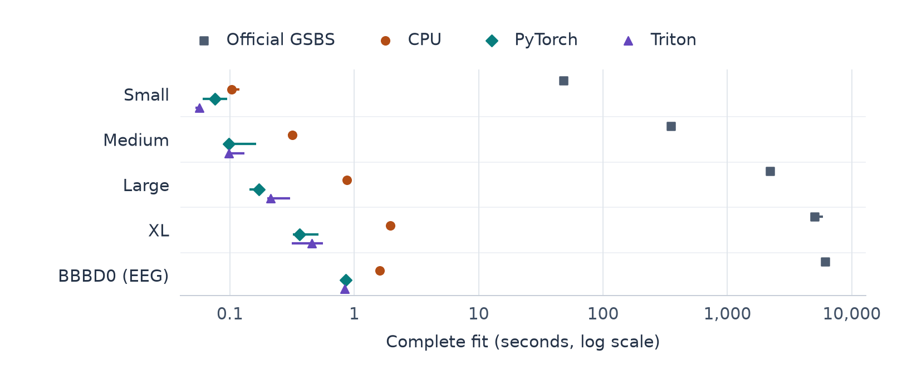
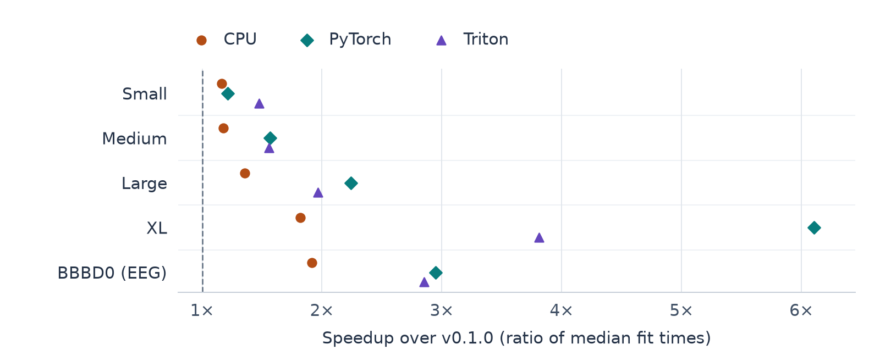

# HP-GSBS

**用于 EEG、fMRI 等多变量时间序列的高性能贪婪状态边界搜索。**

[](https://github.com/JustinZHAO-05/HP-GSBS/releases/tag/v0.2.0)
[](https://github.com/JustinZHAO-05/HP-GSBS/actions/workflows/tests.yml)
[](LICENSE)

[English](README.md) · [文档](docs/index.md) · [论文](https://arxiv.org/abs/2610.25898) · [研究数据与复现代码](https://github.com/JustinZHAO-05/HP-GSBS-SoftwareX-Reproducibility)

## 功能

输入预处理后的 **时间点 × 特征** 矩阵，例如 EEG 通道或 fMRI 体素。HP-GSBS 找出空间活动模式相对稳定的连续时段，返回状态边界、选定的状态数、各状态的空间模式、边界强度和完整的 t-distance 曲线。

- **单条或批量拟合。** 每条记录独立分割，支持 Python API 和命令行，结果可保存为 NumPy 归档。
- **选择计算后端。** CPU 用 `cpu-fast`，NVIDIA GPU 可选 `torch-cuda` 或 `triton-cuda`，也可用 `reference` 调用原始 GSBS 实现。
- **检查分割结果。** 默认使用 FP64，可查看不同状态数下的边界，并记录搜索与微调过程。[API 与验证](docs/v02_api_scope.md) · [发布验证](docs/release_verification_v0.2.0.md)

## 性能

**HP-GSBS v0.2.0 对比官方 GSBS。** 在一条 BBBD EEG 记录上，官方实现完整拟合耗时 6,115 秒，HP-GSBS 的 CPU 后端耗时 1.61 秒，Triton 后端耗时 0.84 秒。两组计时在同一台笔记本上分批完成。



图中点位表示合成负载的中位数或 EEG 单次实测值，线段表示三次合成拟合的实测范围。[测量方法与完整数值](docs/v020_official_comparison.md)

**v0.2 对比 v0.1.0。** 在另一轮交错计时中，实测 v0.2 快照在不同负载和后端组合下的加速为 **1.16–6.11 倍**。



[版本对比与基准细节](docs/performance.md#retained-v010-versus-v02-comparison)

## 原理

GSBS 每轮贪婪地插入一条或两条边界，使各时段更好地拟合各自的空间活动模式。它随后微调边界，并用 t-distance 比较状态内与相邻状态间的相似度，据此选定状态数。

HP-GSBS 预先计算可复用的区间统计量，给候选切分评分时就可以直接复用这些计算结果。候选分块处理，未变化的区块沿用已有分数。CUDA 后端在 GPU 上计算区间分数，再由共用的 CPU 控制器完成顺序搜索和微调。[数学推导](docs/mathematics.md) · [实现架构](docs/architecture.md)

## 用法

需要 **Python 3.10+**。先安装 v0.2.0 发布版的 wheel，即可使用 CPU 后端。

```bash
python -m pip install https://github.com/JustinZHAO-05/HP-GSBS/releases/download/v0.2.0/hpgsbs-0.2.0-py3-none-any.whl
```

下面拟合一段包含四个连续模式的合成信号。处理真实数据时，把 `x` 换成预处理矩阵，并按研究设计设置 `kmax` 和 `dmin`。

```python
import numpy as np
from hpgsbs import GSBSConfig, fit

rng = np.random.default_rng(42)
patterns = rng.normal(size=(4, 8))
x = np.repeat(patterns, 20, axis=0) + 0.15 * rng.normal(size=(80, 8))
result = fit(x, GSBSConfig(kmax=12, dmin=1), backend="cpu-fast")

print(result.nstates)                    # 选定的状态数
print(np.flatnonzero(result.deltas))     # 边界索引
result.save("segmentation.npz")
```

已有 NumPy 输入文件时，可以直接在命令行拟合。

```bash
python -m hpgsbs fit input.npy --kmax 12 --output segmentation.npz
```

使用 GPU 时，先安装兼容 CUDA 的 [PyTorch](https://pytorch.org/get-started/locally/)，然后选择 `torch-cuda`。如需使用 `triton-cuda`，再在 Linux/WSL 上安装 [Triton](https://triton-lang.org/main/getting-started/installation.html)。运行 `python -m hpgsbs doctor` 可检查可用后端。

多条记录可用 `fit_many`，也可通过 `fit-batch` 读取[任务清单](examples/tasks.json)。[完整示例](examples/quickstart.py) · [API 与命令行说明](docs/v02_api_scope.md)

---

如使用本项目，请引用 [HP-GSBS 论文](CITATION.cff)、[软件发布版](https://doi.org/10.5281/zenodo.23422148)和 GSBS 原始研究（[2021](https://doi.org/10.1016/j.neuroimage.2021.118085)、[2022](https://doi.org/10.7554/eLife.77430)）。[论文稿与复现资料](docs/publication.md) · [MIT 许可](LICENSE)
