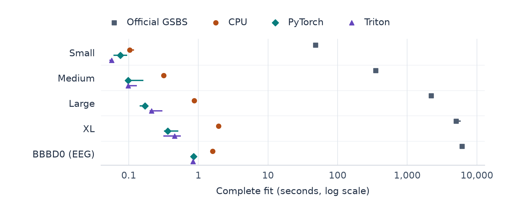
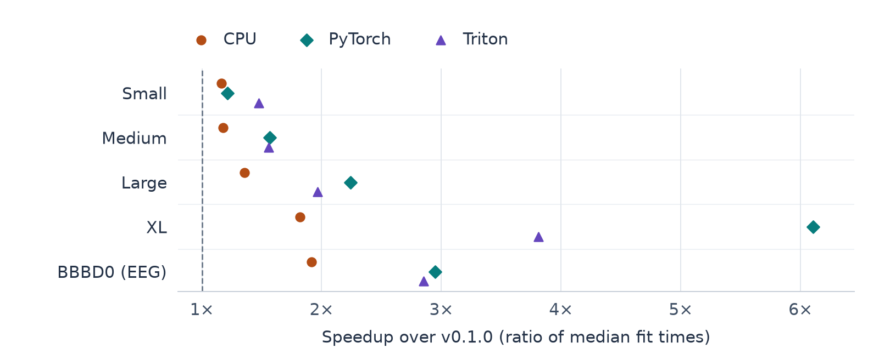

# v0.2 performance and measurement contracts

The homepage first shows [published v0.2.0 versus official GSBS](v020_official_comparison.md): new release-wheel timings compared with the retained official baseline, with cross-session and single-EEG-measurement limitations explicit. The release wheel was remeasured after publication; all 51 warmup/timed fits passed official-output comparisons. This does not replace or alter the historical interleaved experiment below.

[Official comparison table](v020_official_table.md) · [SVG](assets/performance-official-v0.2.0.svg) · [new receipts](../results/releases/v0.2.0/official_comparison.json).

## Retained v0.1.0 versus v0.2 comparison

The retained version-to-version comparison is the actual three-source interleaved experiment in [trials.json](../results/v02/merge_9baff92/revisions/trials.json). Its measured implementation is **9baff923**, compared with actual v0.1.0 and pre-review v0.2 source. That historical matrix did not rebenchmark scheduler snapshot 7da2611 or stable version metadata.

Hardware: Ryzen 7 7840H, RTX 4050 Laptop 6 GB, WSL2 Ubuntu 22.04; FP64, TF32 off, single BLAS/Numba threads, CUDA synchronization. Each workload/backend/source has two warmups and three timed fits. Fit wall excludes output validation/serialization. Same input and scientific configuration within each workload; sources rotate order. All 225 fits passed output checks. Three repeats on one laptop are not cross-machine evidence or confidence intervals.

[Full 15-row comparison](v02_performance_table.md) · [45 unrounded source cells](assets/performance-v0.2.0.json) · [SVG](assets/performance-v0.2.0.svg).

Install Matplotlib with `python -m pip install matplotlib` and run `python scripts/plot_v02_performance.py` to rebuild the figure from saved measurements. The `--check` option compares the detailed table and data with the underlying receipts. The figure shows the ratio of unrounded medians, and the table includes observed min–max fit times. BBBD0 represents one recording with three timed repeats per condition. The retained middle snapshot documents the effect of corrections. A separate focused CPU comparison found 1.4245 s and 1.4496 s medians before and after review, respectively.

## Other measured scopes

- Fit-only throughput: [192 trials over 54 configurations](../results/v02/merge_9baff92/throughput_fit_only/throughput.json), with six explicit memory-admission skips. CPU worker count, GPU batch size, high-K and variable shapes are separate conditions. Mixed-resource scheduling regressions do not establish an extra throughput speedup.
- Restricted long-N: [four sizes](../results/v02/merge_9baff92/long/validation.json), statewise=False, finetune=0, blocksize=0, Kmax=16, raw-prefix/Feature-Moments. 50,000×64: 1.4439 s median, 469.5 MiB peak RSS; selected/final fixed-partition TD error ≤1.15e-14. No full official double-search/finetuning trajectory or same-scale official speed ratio is claimed.
- Ordinary high-K EEG can be slower with low memory; selective resident did not show a robust complete-fit advantage on this GPU. Cold process startup includes imports/JIT and is not warm latency.
- RSS sampling, allocator high-water effects, reserved versus allocated VRAM and component timing scopes are detailed in [original acceptance](v02_merge_readiness.md). Component gains are not multiplied into complete-fit claims.

## Historical evidence

[v0.1 official-GSBS baseline](performance_v0.1.md) and its [original figure](assets/performance-comparison.png) retain their original protocol. [Early v0.2 report](v02_results_CN.md) is explicitly historical (5478fd6/9309874), including slower/failed cases. The retained version-to-version plot uses the corrected 9baff92 receipts rather than updating historical values in place.

Historical verification uses [fixed source commits](v02_migration.md#evidence-snapshots); old manifests are never retargeted to later docs/version commits. The [release verification](release_verification_v0.2.0.md) records later identities and package checks separately.

## Research-paper measurements and applications

The [research reproducibility materials](https://github.com/JustinZHAO-05/HP-GSBS-SoftwareX-Reproducibility) retain a separate controlled paired benchmark: seven configurations, two seeds, 14 configuration/seed cases and 140 timed observations, with 154–1,730-fold median paired speedups. Its [unrounded observations and summaries](https://github.com/JustinZHAO-05/HP-GSBS-SoftwareX-Reproducibility/tree/main/data) and [current manuscript/Online Resource 1](https://github.com/JustinZHAO-05/HP-GSBS-SoftwareX-Reproducibility/tree/main/manuscript) specify the warm-up, repetition and synchronization protocol. The earlier cross-session and version-comparison reports above retain their original scopes and numbers.

The Sherlock application records 17 HP-GSBS CPU fits totaling 213.1028 s on the documented machine. These are application timings for the group response and 16 participants. Official-comparison speedups are drawn from the controlled benchmark. Existing ablation, memory and throughput measurements retain their release-development configurations and observed timing ranges.
