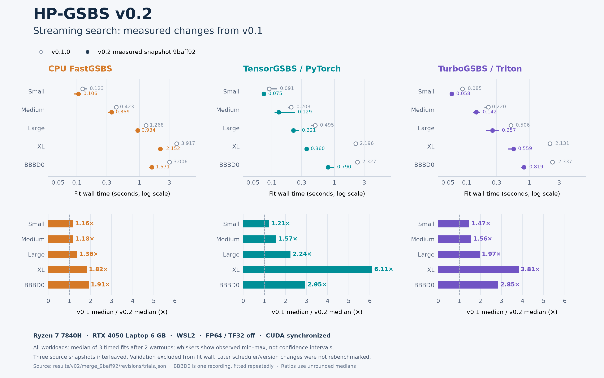

# v0.2 performance and measurement contracts

The primary comparison is the actual three-source interleaved experiment in [trials.json](../results/v02/merge_9baff92/revisions/trials.json). The measured current implementation is **9baff923**, compared with actual v0.1.0 and pre-review v0.2 source. The scheduler snapshot 7da2611 and stable version metadata were not rebenchmarked.

Hardware: Ryzen 7 7840H, RTX 4050 Laptop 6 GB, WSL2 Ubuntu 22.04; FP64, TF32 off, single BLAS/Numba threads, CUDA synchronization. Each workload/backend/source has two warmups and three timed fits. Fit wall excludes output validation/serialization. Same input and scientific configuration within each workload; sources rotate order. All 225 fits passed output checks. Three repeats on one laptop are not cross-machine evidence or confidence intervals.

[Full 15-row comparison](v02_performance_table.md) · [45 unrounded source cells](assets/performance-v0.2.0.json) · [SVG](assets/performance-v0.2.0.svg).

Reproduce the figure without fitting: `python -m pip install matplotlib`, then `python scripts/plot_v02_performance.py`; `--check` independently checks the serialized tables against receipt aggregation and both READMEs. Whiskers are observed min–max. BBBD0 is one recording with three timed repeats per condition, not a participant-level distribution. The retained middle snapshot permits inspection of corrections as well as gains; a separate focused CPU comparison found 1.4245/1.4496 s pre-review/corrected medians, about 1.8% overhead.

## Other measured scopes

- Fit-only throughput: [192 trials over 54 configurations](../results/v02/merge_9baff92/throughput_fit_only/throughput.json), with six explicit memory-admission skips. CPU worker count, GPU batch size, high-K and variable shapes are separate conditions. Mixed-resource scheduling regressions do not establish an extra throughput speedup.
- Restricted long-N: [four sizes](../results/v02/merge_9baff92/long/validation.json), statewise=False, finetune=0, blocksize=0, Kmax=16, raw-prefix/Feature-Moments. 50,000×64: 1.4439 s median, 469.5 MiB peak RSS; selected/final fixed-partition TD error ≤1.15e-14. No full official double-search/finetuning trajectory or same-scale official speed ratio is claimed.
- Ordinary high-K EEG can be slower with low memory; selective resident did not show a robust complete-fit advantage on this GPU. Cold process startup includes imports/JIT and is not warm latency.
- RSS sampling, allocator high-water effects, reserved versus allocated VRAM and component timing scopes are detailed in [original acceptance](v02_merge_readiness.md). Component gains are not multiplied into complete-fit claims.

## Historical evidence

[v0.1 official-GSBS baseline](performance_v0.1.md) and its [original figure](assets/performance-comparison.png) retain their original protocol. [Early v0.2 report](v02_results_CN.md) is explicitly historical (5478fd6/9309874), including slower/failed cases. The primary v0.2 page uses the corrected 9baff92 receipts rather than updating historical values in place.

Historical verification uses [fixed source commits](v02_migration.md#evidence-snapshots); old manifests are never retargeted to later docs/version commits. The [release verification](release_verification_v0.2.0.md) records later identities and package checks separately.
