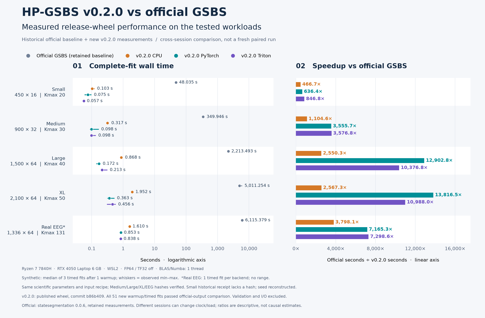

# 正式 v0.2.0 与 official GSBS 的性能对比

本页恢复主页最主要的算法加速基线：最新正式 HP-GSBS 与未修改的 official GSBS。v0.1→v0.2 的同轮版本间比较仍独立保留，二者回答不同问题。



[SVG](assets/performance-official-v0.2.0.svg) · [完整表格](v020_official_table.md) · [未舍入汇总](assets/performance-official-v0.2.0.json) · [正式 wheel 原始回执](../results/releases/v0.2.0/official_comparison.json) · [历史官方基线](../results/benchmarks/delivery_latency.json)

## 来源和计时口径

- HP-GSBS：从公开 Release 下载并验证 SHA256 的 **0.2.0 wheel**，非 editable；源码 tag 目标 `b86b409169aa173d4a361d8cbcc633add1bfacf6`，wheel SHA256 `43f1819b7d8c31adea736345210550b0a5aae4a247e77e363c6650b1b5db749b`。本次于 2026-10-16 UTC / 2026-10-17 Asia/Shanghai 重新计时。
- Official：保留的 `statesegmentation.GSBS==0.0.6` 实测秒数。没有把 v0.1 的优化后端耗时冒充 v0.2，也没有为本次重新运行耗时数小时的全部 official 基准。
- **跨会话描述性比较**：相同机器、OS/Python/NumPy/SciPy/Numba/PyTorch/Triton/CUDA 版本已通过程序逐项匹配；不是同一轮交错测量，不排除桌面负载、温度与频率差异。
- Ryzen 7 7840H、RTX 4050 Laptop 6 GB、WSL2 Ubuntu 22.04，FP64、TF32 off、BLAS/Numba 各 1 线程，trace=False。默认 full-Q / streaming candidate / prefix2d TD；科学参数与历史 official 每个负载相同。
- 合成 Small/Medium/Large/XL：每后端先预热 1 次，再计时 3 次；按 CPU→PyTorch→Triton 顺序轮转。表格为中位数，图中线段为实测 min–max，不是置信区间。
- BBBD0：每后端 1 次计时，无该负载独立预热；进程已由前面合成任务初始化。历史 official 也只有 1 次计时，不估计重复变异，不能视作多个参与者。
- GPU 计时前后同步；测量完整 `fit` 的 wall time，包含计算与必要传输，排除读取输入、验证和保存。不包含 Python 进程启动/导入，不是冷启动测量；不包含批量吞吐。

## 输入身份和科学检查

Medium/Large/XL/BBBD0 的输入 SHA256 与历史官方回执逐项相同，并与保存的官方结果输入逐元素核对。Small 的最早回执没有输入 hash，因此明确保留这一限制：按照当时 `delivery_bench.py` 的 seed=20261016、450×16、Kmax=20 重建，并新跑一次官方 fit 作为验证基线（不采用这次时间覆盖原有三次中位数）。

51 次新拟合（4 个合成负载 × 3 后端 × 4 次，加 1 个 EEG × 3 后端 × 1 次）全部通过完整 all_bounds/K、nstates、t-distance、patterns、strengths 对照。该计时实验不采集逐候选/逐移动 trace；正式版本完整科学验收见[发布后检查](release_verification_v0.2.0.md)。

图中倍数是“保留的 official 秒数 ÷ 本次 v0.2.0 秒数”，直接使用未舍入值，不通过 v0.1→v0.2 的倍数相乘。不同会话、预热合同及负载的结果不能混成一个通用加速倍数；Triton 不保证总比 PyTorch 快。

## 复现

只重建图表，不进行拟合：

```bash
python scripts/plot_official_v020.py
python scripts/plot_official_v020.py --check
```

重新计时使用 `benchmarks/release_official_comparison.py`，在已安装正式 wheel 的环境运行；通过 `--official-receipts`、`--official-environment` 指定两个公开历史 JSON；通过 `--official-results` 指定私有 `completed_*_reference.npz` 所在目录，`--eeg-input` 指定只读原始冻结矩阵，`--output` 必须是不存在的新文件。脚本拒绝环境、参数、输入或数值对照不一致。私有 EEG 及其结果不随仓库发布；公开回执只包含汇总、指纹、环境与验证误差。

## 保留的其他比较

[v0.1→v0.2 同轮交错比较](v02_performance_table.md)、[对应 PNG](assets/performance-v0.2.0.png) 和历史官方基线[原图](assets/performance-comparison.png)均保留原始数字。Long-N 受限单切、实验低内存、吞吐与冷启动仍在各自测量范围中报告，未并入本表。
